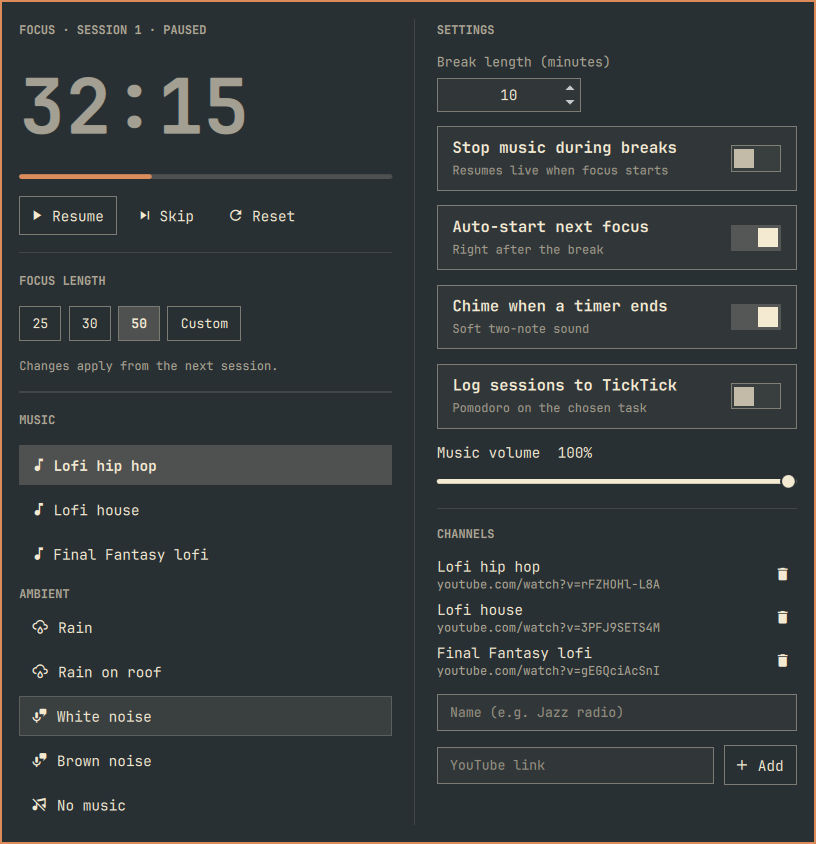

# Omarchy Pomodoro

A pomodoro timer for the [Omarchy](https://omarchy.org) bar, with YouTube live
streams or ambient sounds as focus music, and optional logging of every
session to TickTick.



## Features

- **Bar countdown**: a timer icon next to the clock that turns into the time
  left while a session runs (a cup during breaks, dimmed while paused).
- **Weather-style panel**: the countdown, start / pause / skip / reset, and
  25, 30, 50 or any custom focus length on the left, settings on the right.
- **Focus music**:
  - any YouTube link, live stream or video (videos loop), played through
    `mpv` and `yt-dlp` with no browser and no ads;
  - built-in ambient sounds that work offline: rain, rain on a roof, white
    noise and brown noise.
- **Breaks**: configurable break length, optional auto-start of the next
  focus, and music that stops during breaks and reconnects to the live edge
  of the stream when focus resumes.
- **Gentle chime** and a notification whenever a focus or break ends.
- **TickTick** (optional): pick the task you're working on, and each finished
  focus is logged to TickTick as a pomodoro on that task. TickTick's own timer
  never runs.
- **Survives restarts**: a running timer carries on through a shell restart
  or a re-login.

## Requirements

Omarchy with the Quickshell-based `omarchy-shell`, plus `mpv`, `yt-dlp`,
`jq`, `curl`, `python3` and PipeWire's `pw-play`. All of them ship with
Omarchy or are one `omarchy pkg add` away.

## Install

```bash
omarchy plugin add https://github.com/alessandrobelli/omarchy-pomodoro.git
omarchy plugin enable alessandrobelli.pomodoro --section center
```

Plugins run as unsandboxed code inside the shell, so `omarchy plugin add`
installs it disabled until you enable it. Read the code first if you like:
it's two QML files and a small shell script.

Update later with `omarchy plugin update alessandrobelli.pomodoro`.

## Use

| Where | Action |
|---|---|
| Bar icon, left click | Open or close the panel |
| Bar icon, right click | Start or pause without opening the panel |
| Panel, `Space` | Start or pause |
| Panel, `Esc` | Close |

Pick the music in the panel's **Music** list. Add your own YouTube links under
**Channels** in the settings column.

Scriptable through the shell's IPC, for example from a Hyprland keybinding:

```bash
omarchy-shell alessandrobelli.pomodoro startOrPause   # also: open, toggle, skip, reset, pickTask
```

## TickTick logging

1. In the [TickTick web app](https://ticktick.com/webapp/), open your avatar →
   **Settings** → **Account** → **API Token** and create a token.
2. Save it, and only it, in `~/.config/omarchy/ticktick-token`, readable only
   by you:

   ```bash
   nano ~/.config/omarchy/ticktick-token
   chmod 600 ~/.config/omarchy/ticktick-token
   ```

3. A **Working on** section appears under the timer. Pick a task from what's
   due in the next two weeks, or search all of them.

When a focus ends, or is skipped after at least a minute, it's sent to TickTick
through the official Open API (`POST /open/v1/focus`) with its start and end,
the time actually focused, the paused time, and the task. If TickTick can't be
reached, the session is queued in `~/.local/state/omarchy/` and sent with the
next one. **Reset** abandons a session without logging it. Turn logging off
with **Log sessions to TickTick** in the settings.

The token never leaves your machine except to `api.ticktick.com`, and it's
passed to `curl` on standard input, never as a command-line argument.

## Where things are stored

| What | Where |
|---|---|
| Settings | This widget's entry in `~/.config/omarchy/shell.json` |
| Timer state | `~/.local/state/omarchy/pomodoro.json` |
| TickTick token | `~/.config/omarchy/ticktick-token` |
| Unsent TickTick sessions | `~/.local/state/omarchy/pomodoro-ticktick-queue.jsonl` |

## Notes

- **No Google sign-in.** yt-dlp's YouTube login stopped working in 2024, and
  through mpv there are no ads, so YouTube Premium makes no difference here.
- **If music stops working**, YouTube has usually changed something on its
  side; `omarchy update` brings the fixed `yt-dlp`. The timer keeps running
  regardless, and you get a notification.

## Credits

The rain loops are CC0 field recordings from Freesound; see
[`sounds/CREDITS.md`](sounds/CREDITS.md). The chime is generated.

## License

[MIT](LICENSE)
